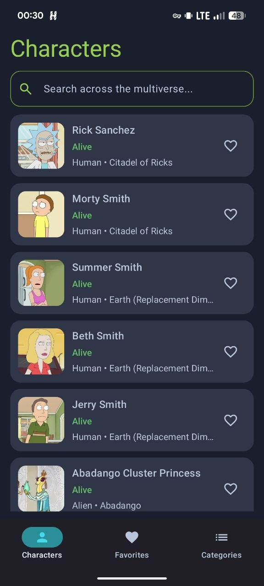
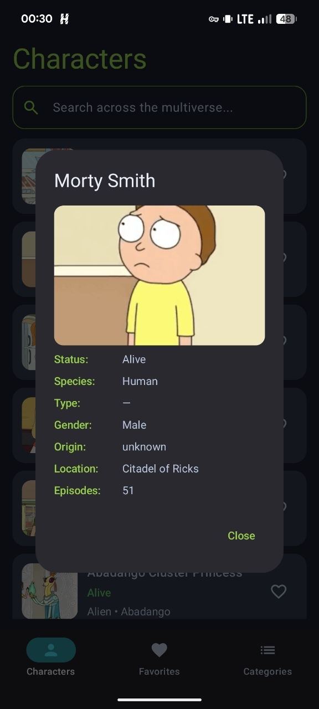
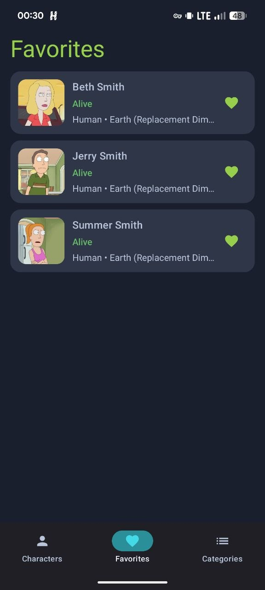

# Rick and Morty

Android-приложение на основе Rick and Morty API.

Приложение позволяет просматривать и искать персонажей вселенной Rick and Morty,
открывать подробную информацию о персонаже и сохранять избранных персонажей
локально на устройстве.

## Скриншоты

  
  
  

## Возможности

- Просмотр списка персонажей с пагинацией
- Поиск персонажей с debounce
- Просмотр подробной информации о персонаже
- Добавление и удаление персонажей из избранного
- Локальное хранение избранных персонажей
- Кэширование и предварительная загрузка изображений
- Обработка сетевых ошибок и повторные запросы

## Стек

- Kotlin
- Jetpack Compose
- Coroutines / Flow / StateFlow
- MVVM / Clean Architecture
- Hilt / Dagger
- Retrofit / OkHttp
- Room
- Coil
- Navigation Compose
- JUnit / MockWebServer

## Архитектура

Приложение разделено на слои `data`, `domain` и `presentation`.

Для разделения работы с данными, бизнес-логики и UI используются
Repository Pattern и Use Cases.

## API

Для получения данных используется Rick and Morty API.